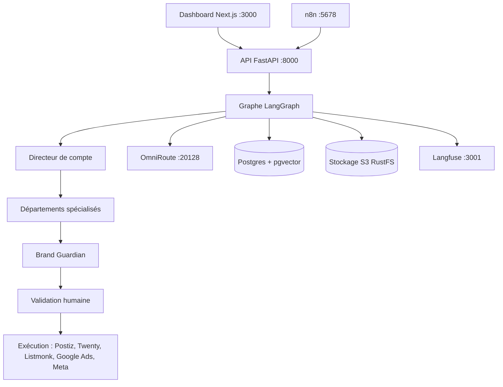

# Agence IA : écosystème multi-agents local

Écosystème multi-agents auto-hébergé pour une agence de marketing digital et de promotion IA. Une équipe d'agents spécialisés (stratégie, contenu, visuels, social, SEO/SEA, analytics, CRM) traite les briefs clients, un Brand Guardian contrôle la qualité, et **toute action externe (publication, email, campagne pub) attend une validation humaine** dans le dashboard.

Tous les modèles passent par **OmniRoute**, la passerelle locale sur `http://localhost:20128/v1`. Aucun code n'est lié à un fournisseur : on change de modèle dans OmniRoute, pas dans le code.



## Démarrage rapide

```bash
cd ~/Desktop/Projects/agence-ia
scripts/init_env.sh          # génère .env avec des secrets aléatoires (une seule fois)
scripts/start.sh             # Docker (core) + OmniRoute + API + dashboard
scripts/start.sh observability automation social crm   # avec tous les services
scripts/start.sh --stop
```

Puis, une seule fois :

1. **Connecter un fournisseur dans OmniRoute** : ouvre http://localhost:20128, ajoute au moins un fournisseur (clé API ou connexion OAuth). Sans fournisseur, aucun agent ne peut répondre.
2. **Créer une clé OmniRoute pour l'agence** (dashboard OmniRoute -> API Keys) et la mettre dans `.env` : `OMNIROUTE_API_KEY=sk-...`, puis relancer `scripts/start.sh`.
3. Ouvrir http://localhost:3000, page **Usage et santé** : OmniRoute doit être « ok » avec au moins un modèle.
4. Page **Clients** : créer un client avec son brand kit, puis lancer un brief depuis la page **Briefs**.

## Modèles par rôle (OmniRoute)

Les agents utilisent trois rôles, configurés dans `.env` :

| Variable | Utilisé par | Valeur par défaut |
|---|---|---|
| `MODEL_STRATEGIE` | Directeur de compte, Stratégie, SEO/SEA, Analytics, juge des évaluations | `auto` |
| `MODEL_REDACTION` | Contenu, Visuels, Social, CRM | `auto` |
| `MODEL_RAPIDE` | Brand Guardian, synthèses | `auto/fast` |
| `MODEL_EMBEDDING` | Mémoire de marque (pgvector), optionnel | vide |
| `MODEL_IMAGE` / `MODEL_TTS` | Agent Visuels | vide |

`auto` fonctionne dès qu'un fournisseur est connecté. Chaque variable accepte aussi une liste séparée par des virgules : les modèles sont alors utilisés à tour de rôle. Pour fixer des modèles précis avec bascule automatique, crée des combos :

```bash
export OMNIROUTE_ADMIN_TOKEN=oma_live_...      # OmniRoute -> Settings -> Access Tokens
uv run --project agents python scripts/omniroute_setup.py models   # liste les modèles disponibles
export COMBO_STRATEGIE_MODELS="provider/modele-raisonnement,provider/modele-secours"
export COMBO_REDACTION_MODELS="provider/modele-redaction"
export COMBO_RAPIDE_MODELS="provider/modele-rapide"
uv run --project agents python scripts/omniroute_setup.py combos
```

Puis dans `.env` : `MODEL_STRATEGIE=agence-strategie`, `MODEL_REDACTION=agence-redaction`, `MODEL_RAPIDE=agence-rapide`.

### Fournisseurs sans appels d'outils

Certains fournisseurs OmniRoute (passerelles web gratuites comme `cfp/` ou `ddgw/`) ignorent les paramètres `tools` et `response_format`. Avec `TOOL_MODE=prompt`, les outils et le schéma JSON attendu sont décrits dans le prompt, la réponse est parsée puis validée, avec relance en cas de format invalide. Garde `TOOL_MODE=native` pour les fournisseurs API classiques (OpenAI, Anthropic, Gemini, Groq…), plus rapides et plus fiables.

Configuration testée sans fournisseur payant :

```
TOOL_MODE=prompt
MODEL_STRATEGIE=cfp/zai-org/glm-5.2,cfp/deepseek-ai/deepseek-v4-pro-0813,cfp/openai/gpt-oss-120b,cfp/nvidia/nemotron-3-120b-a12b,cfp/moonshotai/kimi-k2.7-code
MODEL_REDACTION=cfp/moonshotai/kimi-k2.6,cfp/meta-llama/llama-3.3-70b-instruct-fp8-fast,cfp/mistralai/mistral-small-3.1-24b-instruct,cfp/google/gemma-4-26b-a4b-it
MODEL_RAPIDE=cfp/deepseek-ai/deepseek-v4-flash-0731,cfp/zai-org/glm-4.7-flash,cfp/openai/gpt-oss-20b,cfp/qwen/qwen3-30b-a3b-fp8,cfp/meta/llama-4-scout-17b-16e-instruct
```

Compte environ une minute par appel de modèle : un run stratégie + contenu prend une dizaine de minutes.

### Clé et quotas par client

```bash
uv run --project agents python scripts/omniroute_setup.py key "Client ACME" --daily 5 --weekly 25
uv run --project agents python scripts/omniroute_setup.py quota <key_id> --daily 10
```

Colle la clé dans la fiche client du dashboard. Les tokens consommés sont suivis par client, rôle et modèle dans la page **Usage et santé** ; les coûts en dollars et les quotas sont dans OmniRoute.

## Fonctionnement d'un run

1. **Plan** : le Directeur de compte découpe le brief en tâches (ou utilise les départements cochés).
2. **Départements** : exécutés dans l'ordre stratégie, SEO, analytics, contenu, visuels, social, CRM ; chacun voit les livrables des précédents, le brand kit du client et ses outils.
3. **Brand Guardian** : contrôle ton, conformité et exactitude ; renvoie les départements concernés en révision (1 révision automatique par défaut, `MAX_REVISIONS`).
4. **Livrable** : synthèse + rapports, exporté en PDF dans le stockage S3.
5. **Validation humaine** : valider (en choisissant les actions à exécuter), demander une révision avec un retour, ou rejeter. Les veilles automatiques sans action se terminent sans validation.
6. **Exécution** des actions validées. Une action en échec n'empêche pas les autres.

L'état des runs est persisté dans Postgres (checkpointer LangGraph) : une validation peut avoir lieu des jours plus tard.

## Agents, outils et actions

| Département | Outils | Actions soumises à validation |
|---|---|---|
| Stratégie et veille | recherche web (SearXNG local ou Tavily), lecture de pages | - |
| SEO et SEA | audit on-page, Search Console, Google Ads, Meta Ads | `google_ads_create_campaign`, `meta_create_campaign` (toujours en PAUSE) |
| Analytics | GA4, Search Console, Google Ads, Meta Ads, canaux Postiz | - |
| Contenu | recherche web | - |
| Visuels | génération d'images et de voix off via OmniRoute | - |
| Social media | canaux Postiz | `postiz_schedule` |
| CRM | Twenty CRM, listes Listmonk, recherche web | `crm_create_company`, `crm_create_person`, `email_campaign` |

Un outil non configuré ne bloque pas l'agent : il le signale dans son livrable. Les intégrations se configurent dans `.env` (clés globales) et dans les **paramètres JSON** de chaque client (`ga4_property_id`, `search_console_site`, `google_ads_customer_id`, `meta_ad_account_id`, `postiz_integration_ids`, `listmonk_list_ids`). Voir [docs/integrations.md](docs/integrations.md).

## Services

| Service | URL | Profil Docker |
|---|---|---|
| Dashboard de l'agence | http://localhost:3000 | (Node, hôte) |
| API des agents | http://localhost:8000/docs | (Python, hôte) |
| OmniRoute | http://localhost:20128 | (Node, hôte) |
| Postgres + pgvector | localhost:5433 | core |
| Redis | localhost:6380 | core |
| Stockage S3 (RustFS) | http://localhost:9001 (console) | core |
| SearXNG | http://localhost:8888 | core |
| Langfuse | http://localhost:3001 | observability |
| n8n | http://localhost:5678 | automation |
| Postiz (+ Temporal) | http://localhost:4007 | social |
| Twenty CRM | http://localhost:3002 | crm |
| Listmonk | http://localhost:9002 | crm |

Tous les ports sont liés à `127.0.0.1`, sauf l'API (`0.0.0.0:8000`, protégée par `AGENCE_API_KEY`) pour que n8n puisse l'appeler depuis Docker. Identifiants admin (Langfuse, Listmonk) : `ADMIN_EMAIL` / `ADMIN_PASSWORD` dans `.env`.

> MinIO ne publie plus d'images Docker : le stockage S3 utilise RustFS, compatible S3.

### Pare-feu : accès des conteneurs à l'hôte

n8n et Postiz appellent l'API (`:8000`) et OmniRoute (`:20128`) via `host.docker.internal`. Si le pare-feu de l'hôte (ufw) bloque ce trafic, autorise les réseaux Docker :

```bash
sudo ufw allow from 172.16.0.0/12 to any port 8000,20128 proto tcp
```

## Automatisations n8n

```bash
scripts/start.sh automation
scripts/n8n_import.sh
```

Les workflows sont importés désactivés ; active-les dans http://localhost:5678 après vérification.

| Workflow | Déclenchement | Effet |
|---|---|---|
| Erreurs des automatisations | erreur d'un workflow | alerte dans le dashboard (page Usage et santé) |
| Veille quotidienne | lun-sam 7h30 | run Stratégie pour les clients avec `daily_watch: true` |
| Rapports hebdomadaires | lundi 8h | run Analytics + PDF pour les clients avec `weekly_report: true` |
| Relances CRM | mardi et jeudi 9h | run CRM pour les clients avec `crm_followups: true` |
| Rappel des validations | jours ouvrés 10h et 16h | notification des livrables en attente |
| Article de blog vers social | nouvel article RSS | run contenu + visuels + social, publication Postiz après validation |
| Générateur de texte rapide | webhook `POST /webhook/generer-texte` | appel direct à OmniRoute |

Pour utiliser les nœuds IA natifs de n8n, crée une credential **OpenAI** avec l'URL de base `http://host.docker.internal:20128/v1` et ta clé OmniRoute.

## Qualité, sauvegardes, tests

```bash
# Évaluation des agents sur des briefs de référence (agents/evals/briefs.json), scores dans Langfuse
cd agents && uv run agence-eval --min-score 7

# Sauvegarde : Postgres, assets S3, base OmniRoute, .env (garde les 14 dernières)
scripts/backup.sh
scripts/restore.sh backups/<date>

# Tests (sans fournisseur réel, avec un faux OmniRoute)
cd agents && uv run pytest -q tests/test_tools.py
uv run uvicorn tests.mock_omniroute:app --port 20199 &
OMNIROUTE_BASE_URL=http://localhost:20199/v1 OMNIROUTE_API_KEY=test uv run uvicorn agence.api.main:app --port 8010 &
AGENCE_TEST_URL=http://localhost:8010 uv run python tests/e2e.py
```

Sauvegarde automatique chaque nuit : `crontab -e` puis
`0 2 * * * $HOME/Desktop/Projects/agence-ia/scripts/backup.sh >> $HOME/Desktop/Projects/agence-ia/logs/backup.log 2>&1`

Langfuse (profil `observability`) est initialisé avec le projet `agence-ia` et les clés de `.env` : les traces apparaissent automatiquement dès qu'il tourne au démarrage de l'API.

## Structure

```
agents/                    API et agents (Python, uv)
  src/agence/
    api/main.py            API FastAPI (clients, runs, validations, usage, automatisations)
    graphs/agency.py       graphe LangGraph (plan, départements, Brand Guardian, validation, exécution)
    graphs/departments.py  registre des départements : rôle, outils, actions
    prompts/               consignes de chaque agent (Markdown, en français)
    tools/                 web, SEO, analytics, ads, visuels, Postiz, CRM
    llm.py                 accès aux modèles via OmniRoute + suivi d'usage
    memory.py              brand kits et recherche pgvector
    runner.py              exécution en arrière-plan et reprise après validation
    evals.py               évaluation qualité
  evals/briefs.json        cas d'évaluation
  tests/                   faux OmniRoute, tests outils, test de bout en bout
dashboard/                 Next.js
n8n/workflows/             workflows n8n versionnés
infra/                     init Postgres, SearXNG, Temporal
scripts/                   init, démarrage, OmniRoute, n8n, sauvegardes
```
