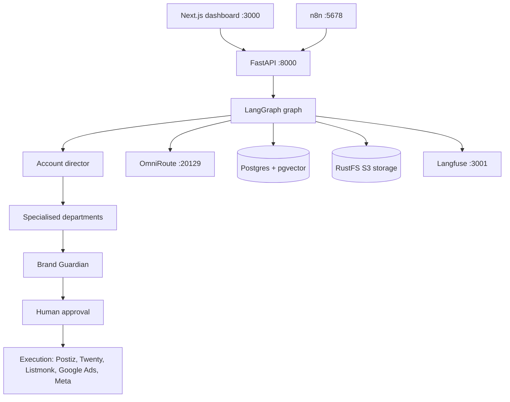

**English** | [Français](README.fr.md)

# Ai-Agency: a self-hosted multi-agent system

[](https://github.com/NefziSofien/Ai-Agency/actions/workflows/ci.yml)

A self-hosted multi-agent system for a digital marketing agency. A team of specialised agents (strategy, content, visuals, social, SEO/SEA, analytics, CRM) handles client briefs, a Brand Guardian checks quality, and **every external action (publishing, email, ad campaign) waits for human approval** in the dashboard.

All models go through **OmniRoute**, a local gateway on `http://localhost:20129/v1`. No code is tied to a provider: you change models in OmniRoute, not in the code.

> Agent prompts and the dashboard are in French. See [LESSONS.md](LESSONS.md) for what broke and what I would change.



## Quick start

```bash
git clone https://github.com/NefziSofien/Ai-Agency.git agence-ia && cd agence-ia
scripts/init_env.sh          # generates .env with random secrets (once)
scripts/start.sh             # Docker (core) + OmniRoute + API + dashboard
scripts/start.sh observability automation social crm   # with all services
scripts/start.sh --stop
```

Then, once:

1. **Connect a provider in OmniRoute:** open http://localhost:20129 and add at least one provider. Without one, no agent can respond.
2. **Create an OmniRoute key for the agency** (OmniRoute dashboard, API Keys), set `OMNIROUTE_API_KEY=sk-...` in `.env`, then rerun `scripts/start.sh`.
3. **Check health:** open http://localhost:3000, page **Usage et santé**. OmniRoute should be "ok" with at least one model.
4. **Run a brief:** create a client with a brand kit on the **Clients** page, then start a brief from the **Briefs** page.

## How a run works

1. **Plan:** the account director splits the brief into tasks, or uses the selected departments.
2. **Departments:** they run in order (strategy, SEO, analytics, content, visuals, social, CRM). Each one sees earlier deliverables, the client's brand kit and its own tools.
3. **Brand Guardian:** checks tone, compliance and accuracy, and sends departments back for revision (one automatic revision by default, `MAX_REVISIONS`).
4. **Deliverable:** a summary and reports, exported as PDF to S3 storage.
5. **Human approval:** approve (choosing which actions to execute), request a revision with feedback, or reject. Automated monitoring runs with no actions finish without approval.
6. **Execution** of the approved actions. A failed action does not stop the others.

Run state is persisted in Postgres (LangGraph checkpointer), so approval can happen days later.

## Agents, tools and actions

| Department | Tools | Actions requiring approval |
|---|---|---|
| Strategy and monitoring | web search (local SearXNG or Tavily), page reading | - |
| SEO and SEA | on-page audit, Search Console, Google Ads, Meta Ads | `google_ads_create_campaign`, `meta_create_campaign` (always paused) |
| Analytics | GA4, Search Console, Google Ads, Meta Ads, Postiz channels | - |
| Content | web search | - |
| Visuals | image and voice-over generation through OmniRoute | - |
| Social media | Postiz channels | `postiz_schedule` |
| CRM | Twenty CRM, Listmonk lists, web search | `crm_create_company`, `crm_create_person`, `email_campaign` |

An unconfigured tool does not block the agent: it reports the gap in its deliverable. Integrations are configured in `.env` and in each client's JSON settings. See [docs/integrations.md](docs/integrations.md) (French).

## Model roles

| Variable | Used by | Default |
|---|---|---|
| `MODEL_STRATEGIE` | Account director, strategy, SEO/SEA, analytics, evaluation judge | `auto` |
| `MODEL_REDACTION` | Content, visuals, social, CRM | `auto` |
| `MODEL_RAPIDE` | Brand Guardian, summaries | `auto/fast` |
| `MODEL_FALLBACK` | Backup models, tried in order when a call fails | empty |
| `MODEL_EMBEDDING` | Brand memory (pgvector), optional | empty |
| `MODEL_IMAGE` / `MODEL_TTS` | Visuals agent | empty |

Some providers ignore `tools` and `response_format`. With `TOOL_MODE=prompt`, tools and the expected JSON schema are described in the prompt, and the reply is parsed, validated and retried if invalid. Keep `TOOL_MODE=native` for standard API providers, which are faster and more reliable.

## Quality, backups, tests

```bash
# Evaluate agents on reference briefs (agents/evals/briefs.json), scores go to Langfuse
cd agents && uv run agence-eval --min-score 7

# Back up Postgres, S3 assets, the OmniRoute database and .env (keeps the last 14)
scripts/backup.sh
scripts/restore.sh backups/<date>

# Tests, with no real provider
cd agents && uv run pytest -q tests/test_tools.py tests/test_llm.py tests/test_security.py
```

Backups include a copy of `.env`, so keep `backups/` local or encrypt it before any transfer.

## Security

This project is designed for a **trusted machine or server, not exposed to the internet**.

- The dashboard has **no authentication**: anyone who reaches it controls the API. Put it behind an authenticated reverse proxy (VPN, SSO, basic auth).
- If `AGENCE_API_KEY` is empty, the API is not authenticated. `scripts/init_env.sh` generates it. The API listens on `0.0.0.0:8000` for n8n in Docker: filter the port at the firewall, or set `API_HOST=127.0.0.1` if you do not use n8n.
- `.env` holds all secrets and is ignored by git. Never commit it.
- The `fetch_page` tool refuses non-public addresses (SSRF protection), and external actions always require human approval.
- n8n can read environment variables (`N8N_BLOCK_ENV_ACCESS_IN_NODE=false`): only import trusted workflows.
- Postiz accepts sign-ups (`DISABLE_REGISTRATION=false`): set it to `true` once your account exists.
- Docker images use `latest`: pin versions for a durable deployment.

Reporting vulnerabilities: [SECURITY.md](SECURITY.md). Contributing: [CONTRIBUTING.md](CONTRIBUTING.md). License: [MIT](LICENSE).

The full French documentation, including n8n workflows, per-client quotas and all service ports, is in [README.fr.md](README.fr.md).
